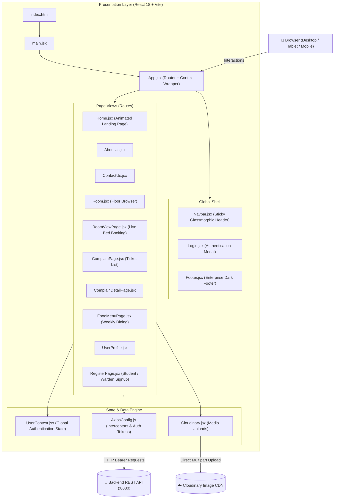
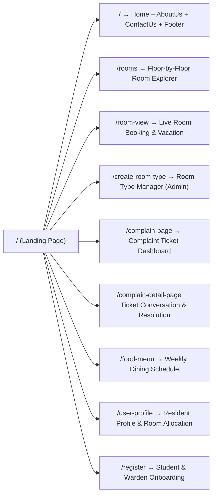
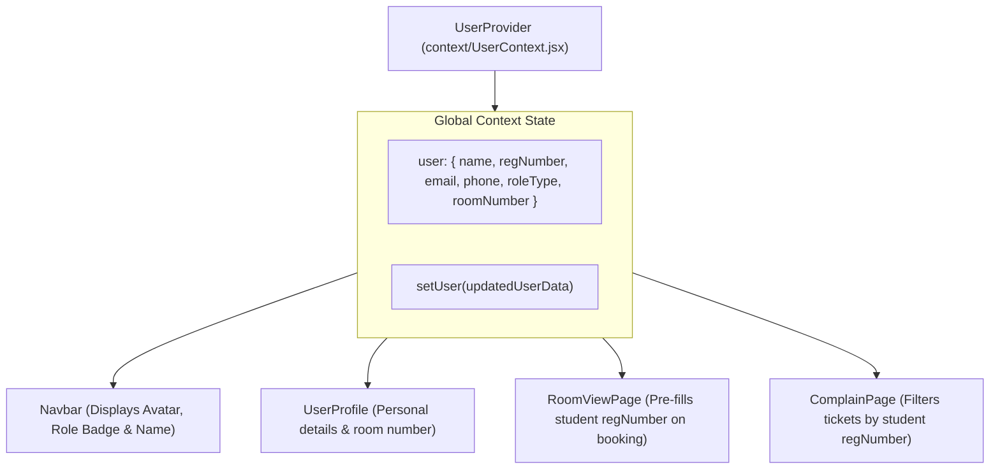
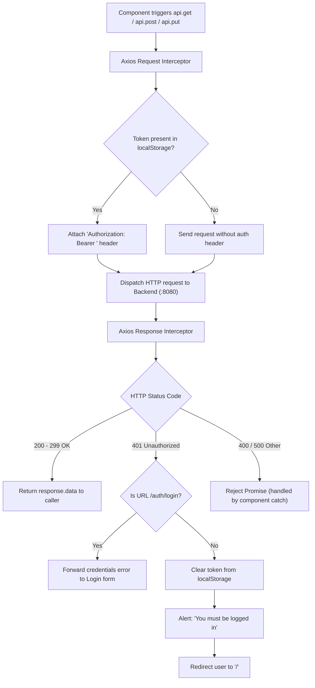

# 🏨 Smart Hostels — Frontend System Design (HMS-GUI)

> **Service:** Client-Side Single Page Application (SPA)  
> **Repository:** [HMS-GUI](https://github.com/BhanuBurman/HMS-GUI.git)  
> **Tech Stack:** React 18 / 19 · Vite 6 · Tailwind CSS 4 · Framer Motion 12 · Axios · React Router DOM 7  
> **Architecture Pattern:** Component-Driven SPA with Global Context & Centralized API Interceptors  

---

## Table of Contents

1. [High-Level Architecture](#1-high-level-architecture)
2. [Technology Stack & Dependencies](#2-technology-stack--dependencies)
3. [Component Hierarchy & Structure](#3-component-hierarchy--structure)
4. [Client-Side Route Map](#4-client-side-route-map)
5. [Global State Management (UserContext)](#5-global-state-management-usercontext)
6. [Axios Interceptor & Security Pipeline](#6-axios-interceptor--security-pipeline)
7. [Design System & Animation Architecture](#7-design-system--animation-architecture)
8. [Asset Management & Cloudinary Integration](#8-asset-management--cloudinary-integration)
9. [Configuration & Environment Variables](#9-configuration--environment-variables)
10. [Local Development & Production Build](#10-local-development--production-build)

---

## 1. High-Level Architecture

The frontend is built as a fast, reactive Single Page Application (SPA) bundled with Vite. It features a modern dark-mode aesthetic with frosted glassmorphism, responsive navigation, and hardware-accelerated animations using Framer Motion.



---

## 2. Technology Stack & Dependencies

| Tool / Library | Version | Role in Architecture |
| :--- | :--- | :--- |
| **React** | 18 / 19 | Declarative UI component tree & Virtual DOM |
| **Vite** | 6.2+ | Next-gen lightning-fast dev server with Instant HMR |
| **Tailwind CSS** | 4.0 (@tailwindcss/vite) | Utility-first responsive styling and theme variables |
| **Framer Motion** | 12.6+ | Declarative physics-based animations, layout transitions & modals |
| **React Router DOM** | 7.4+ | Client-side routing, protected navigation, URL state |
| **Axios** | 1.8+ | Promise-based HTTP client with request/response interceptors |
| **React Icons** | 5.5+ | Vector iconography (`react-icons/hi2`, `react-icons/fa`, `react-icons/si`) |

---

## 3. Component Hierarchy & Structure

```
frontend/src/
├── main.jsx                         # ReactDOM root bootstrap
├── App.jsx                          # Root routes & UserProvider wrapper
├── index.css                        # Tailwind v4 import & custom glow utilities
│
├── config/
│   └── AxiosConfig.js               # Centralized Axios instance with auth interceptors
│
├── context/
│   └── UserContext.jsx              # Global user profile and role provider
│
├── components/                      # Shared Reusable Components
│   ├── Navbar.jsx                   # Glassmorphic header with user dropdown & mobile menu
│   ├── Login.jsx                    # Modal login dialog with role switch
│   ├── Footer.jsx                   # Dark enterprise footer with operational status
│   ├── AboutUs.jsx                  # Architectural pillars & tech stack section
│   ├── ContactUs.jsx                # Emergency helpline cards & inquiry form
│   ├── CreateRooms.jsx              # Admin room & bed provisioning dialog
│   ├── StudentRegistration.jsx      # Multi-field student registration form
│   ├── WardenRegistration.jsx       # Administrative warden onboarding form
│   └── Spinner.jsx                  # Loading spinners and button spinners
│
├── pages/                           # Route-Bound Page Views
│   ├── Home.jsx                     # High-impact landing page (Hero, Bento grid, FAQs, Stats)
│   ├── Room.jsx                     # Floor-wise room browser
│   ├── RoomViewPage.jsx             # Bed selection, booking & room vacation
│   ├── CreateRoomType.jsx           # Room category and amenity configurations
│   ├── ComplainPage.jsx             # Ticket dashboard (Pending, In-Progress, Resolved)
│   ├── ComplainDetailPage.jsx       # Detailed ticket discussion thread & status updates
│   ├── FoodMenuPage.jsx             # Day-by-day weekly dining timetable
│   ├── UserProfile.jsx              # Resident/warden profile and allocated room info
│   └── RegisterPage.jsx             # Split-tab registration container
│
├── utils/
│   └── Cloudinary.jsx               # Direct browser-to-Cloudinary image upload utility
│
└── assets/                          # Static branding, room images & textures
    ├── hostel-front-img.jpg
    ├── food-menu-bg.jpg
    ├── room_img.jpg
    └── complain_default.png
```

---

## 4. Client-Side Route Map



---

## 5. Global State Management (UserContext)

Authentication state and resident profiles are managed globally using the **React Context API**, preventing prop drilling across independent pages.



---

## 6. Axios Interceptor & Security Pipeline

All HTTP requests pass through [`AxiosConfig.js`](file:///D:/Final%20Year%20Projects/Hostel%20Management%20System/frontend/src/AxiosConfig.js), ensuring automatic bearer token attachment and central handling of authentication failures (HTTP 401).



---

## 7. Design System & Animation Architecture

### 7.1 Styling Foundations
* **Color Palette:**
  * Dark Canvas: `#0b0f19` (Background), `#070a11` (Footer)
  * Card Surfaces: `bg-slate-900/60`, `border-slate-800/80`, `backdrop-blur-xl`
  * Primary Accent: `from-blue-600 via-indigo-600 to-cyan-500`
  * Status Colors: Emerald (Resolved / Available), Amber (Pending / In-Progress), Rose (Rejected / Full)
* **Custom Utilities (`index.css`):**
  * `.animate-pulse-glow`: Ambient breathing glow for background gradient orbs.
  * Custom dark micro-scrollbars.
  * Smooth client scroll transitions (`scroll-behavior: smooth`).

### 7.2 Framer Motion Dynamics
* **Hero Section:**
  * Spring-animated badge entrance (`opacity: 0, y: 30` -> `opacity: 1, y: 0`).
  * Continuous floating card badges with oscillating vertical motion (`y: [0, -6, 0]`).
* **Feature Grid:**
  * Interactive hover lifts (`whileHover: { y: -6 }`) with glowing border transitions.
* **FAQ Accordion:**
  * Fluid height animations via `AnimatePresence` (`height: 0` to `height: "auto"`).
* **Navigation Menus:**
  * Smooth modal fade-in and animated mobile drawer transitions.

---

## 8. Asset Management & Cloudinary Integration

* **Static Assets:** Hosted in `src/assets/` and optimized by Vite's rollup bundling.
* **Dynamic Media Uploads:** When adding new rooms with photos, [`Cloudinary.jsx`](file:///D:/Final%20Year%20Projects/Hostel%20Management%20System/frontend/src/utils/Cloudinary.jsx) uploads files directly to Cloudinary using unsigned presets:
  ```javascript
  const res = await axios.post(
    `https://api.cloudinary.com/v1_1/${cloudName}/image/upload`,
    formData
  );
  return res.data.secure_url; // Persisted to backend RoomEntity
  ```

---

## 9. Configuration & Environment Variables

The frontend is configured via `.env` files matching development and production backends.

```env
# API Endpoints
VITE_API_URL_DEV=http://localhost:8080
VITE_API_URL_PROD=https://hostel-management-system-2bhd.onrender.com

# Cloudinary CDN Configuration
VITE_CLOUD_NAME=dv5lxe8m7
VITE_CLOUD_PRESET_NAME=meme-uploads
```

---

## 10. Local Development & Production Build

### 10.1 Running Local Dev Server
```powershell
cd frontend
npm.cmd install
npm.cmd run dev
```
* **Local Server:** `http://localhost:5173`
* Hot Module Replacement (HMR) active for instant component updates.

### 10.2 Building for Production
```powershell
npm.cmd run build
```
* Outputs optimized chunks, CSS minification, and static assets to the `dist/` directory ready for deployment on Netlify or Vercel.
