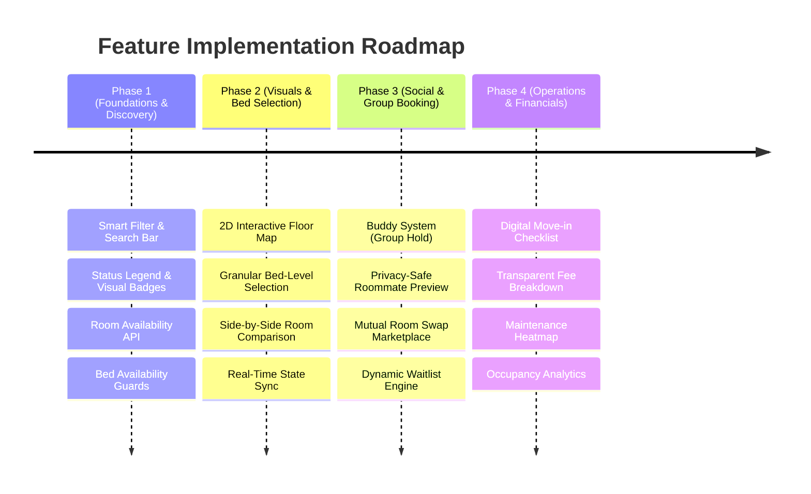
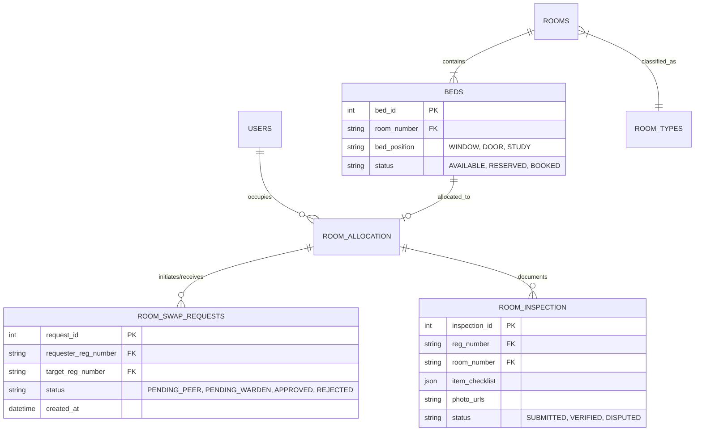

# Product Feature Plans: Smart Hostel Management System (HMS)

> **Document Version:** 1.0.0  
> **Target System:** Next-Gen Campus Living & Accommodation SaaS  
> **Audience:** Product Managers, UI/UX Engineers, Backend Architects, Stakeholders  

---

## 1. Executive Summary & Vision

The **Smart Hostel Management System (HMS)** aims to evolve from a basic administrative CRUD booking tool into a **consumer-grade, student-centric living portal**. 

In university accommodation, booking a room is not merely selecting a database record; it is one of the most critical lifestyle and academic decisions a student makes each year. This document defines the customer-centric feature roadmap designed to maximize student satisfaction, reduce administrative friction for wardens, and eliminate booking disputes.

---

## 2. Customer Personas & Core Pain Points

### Persona 1: The Student (Primary End-User / Consumer)
* **Anxiety Over Roommates:** Moving in with strangers without knowing lifestyle habits (sleep schedule, branch, study intensity) causes friction.
* **Lack of Spatial Context:** Room numbers (`B-002`) convey no information about sunlight, noise levels, proximity to restrooms, elevators, or water coolers.
* **Bed Position Preferences:** In shared rooms (2/3/4 beds), fighting over the "window bed" or "lower bunk" is common.
* **Separation from Friends:** Friends cannot coordinate simultaneous reservations without the risk of someone being left behind.
* **Post-Allocation Inflexibility:** No structured way to swap rooms without flooding campus WhatsApp groups.

### Persona 2: The Warden / Administration (Operations & Governance)
* **Room Damage & Dispute Settlements:** High friction at checkout over pre-existing room damages and security deposit deductions.
* **Manual Room Swap Overhead:** Endless paper petitions from students wishing to switch rooms.
* **Occupancy Blind Spots:** Inability to visualize real-time wing-level occupancy, utility usage, or maintenance hotspots.

---

## 3. Product Feature Roadmap

---

## 4. Detailed Feature Specifications

### Feature 1: Interactive 2D/3D Floor Plan ("Seat-Map" Experience)
* **Problem:** Students cannot gauge spatial factors like noise, elevator traffic, or sunlight.
* **Solution:** A visual interactive blueprint for each hostel floor inspired by airline and cinema seat-selection maps.
* **Key Capabilities:**
  - **Landmark Anchors:** Clearly indicates lifts, emergency staircases, washrooms, water dispensers, Wi-Fi routers, and balconies.
  - **Wing Categorization:** Visual distinction for Quiet Zones, Courtyard-facing rooms, and Road-facing rooms.
  - **Live Color Heatmap:**
    - 🟢 Green: Multiple beds available.
    - 🟡 Amber: Last bed remaining.
    - 🔴 Red: Fully occupied.
    - 🟣 Indigo: Student’s currently reserved room.
    - ⚪ Gray: Under maintenance / locked by warden.
  - **Interactive Hover Cards:** Instant tooltip showing bed count, room type (AC/Non-AC), and starting price.

---

### Feature 2: Granular Bed-Level Selection
* **Problem:** Currently, students book an entire room without choosing their specific spot.
* **Solution:** Interactive mini-layout for shared rooms (2-bed, 3-bed, 4-bed, 6-bed).
* **Key Capabilities:**
  - **Specific Bed Labels:**
    - `Bed A (Window-side, Left)`
    - `Bed B (Near Entrance / Door)`
    - `Bed C (Adjacent to Study Desk)`
    - `Bunk Top / Bunk Bottom`
  - **Occupied Bed Avatar:** Shows whether a specific bed is already taken.
  - **Database Enforcement:** Bed-level pessimistic locking (`bed_id` association in `room_allocation`).

---

### Feature 3: Roommate Discovery & "Buddy System" (Group Booking)
* **Problem:** Students cannot coordinate with friends or screen potential roommates.
* **Solution:** Privacy-safe occupant profiles and collaborative group reservations.
* **Key Capabilities:**
  - **Privacy-Safe Lifestyle Badges:** When inspecting a partially booked room, students see opt-in tags from current occupants:
    - *Academic:* "3rd Year CSE", "GATE/UPSC Aspirant"
    - *Habits:* "Early Riser (6 AM)", "Night Owl (2 AM)", "Silent Study"
    - *Lifestyle:* "Vegetarian", "Fitness / Athlete"
  - **Buddy Booking ("Group Hold"):**
    - A student initiates a group booking for 2 to 4 friends.
    - System places a **10-minute pessimistic hold** on all beds in the chosen room.
    - Generates a secure invite link or code for friends.
    - If all friends confirm within 10 minutes, the room is atomically locked for the group. If the timer expires, the hold is released.

---

### Feature 4: Smart Filtering & Side-by-Side Comparison
* **Problem:** Students must click through every room card sequentially to see prices and amenities.
* **Solution:** Multi-criteria filter drawer and side-by-side comparison modal.
* **Key Capabilities:**
  - **Filter Criteria:**
    - **Room Category:** Single Deluxe, 2-Bed Sharing, 3-Bed Sharing, 4-Bed Bunk.
    - **Climate Control:** Air Conditioned (AC) vs Naturally Ventilated (Non-AC).
    - **Washroom Type:** Attached Private Bath vs Common Floor Washroom.
    - **Floor Preference:** Ground Floor (Accessibility/Quick Exit) vs Higher Floors (Quiet).
    - **Price Range:** Dual-slider for semester accommodation fees.
  - **Side-by-Side Comparison Drawer:**
    - Compare up to 3 selected rooms across price, furniture inventory, window orientation, and occupant count.

---

### Feature 5: Mutual Room Swap & Dynamic Waitlist Marketplace
* **Problem:** Post-allocation changes currently require tedious manual petitions to the hostel office.
* **Solution:** Self-service peer-to-peer room exchange with automated audit logs.
* **Key Capabilities:**
  - **Room Swap Board:** A student posts their room with preferences (e.g., *"Assigned B-104 (Non-AC), looking for any AC room on Floor 2 or 3"*).
  - **Two-Way Mutual Consent:** When a match is found, both students must approve the swap with OTP/password credentials.
  - **One-Click Warden Approval:** Submits the swap to the warden’s dashboard for final 1-click confirmation, atomically swapping database references.
  - **Smart Waitlist ("Notify Me"):** If high-demand rooms (e.g., Single AC) are sold out, students join a waitlist. When a vacancy occurs (cancellation or vacation), waitlisted students receive instant SMS/Email/In-App notifications.

---

### Feature 6: Digital Move-In Inventory & Room Condition Checklist
* **Problem:** Students face unfair deductions from their caution deposits due to pre-existing damage.
* **Solution:** Digital inspection workflow on check-in.
* **Key Capabilities:**
  - **48-Hour Inspection Window:** Upon room allocation, the student has 48 hours to complete a checklist.
  - **Item Verification:** Rate the condition of Fan, Study Table, Chair, Almira, Switchboards, Window Latch, and Wall Paint.
  - **Photo Evidence:** Upload up to 5 photos directly to Cloudinary for pre-existing scratches or defects.
  - **Timestamped Audit Report:** Both student and warden receive a digitally signed copy of the move-in condition.

---

### Feature 7: Transparent Fee Breakdown & Payment Schedule
* **Problem:** Lump-sum figures like `₹65,000` lack clarity on inclusions and caution deposits.
* **Solution:** Detailed cost breakdown accordion with payment milestone tracking.
* **Key Capabilities:**
  - **Transparent Ledger:**
    - Base Room Rent: `₹45,000`
    - Caution Deposit (100% Refundable): `₹5,000`
    - Utility & Electricity Quota (250 units included): `₹5,000`
    - High-Speed Wi-Fi & Maintenance Levy: `₹5,000`
    - Mess / Dining Charges (Optional Add-on): `₹18,000`
  - **Installment Milestones:** Option to pay 50% upon booking and 50% prior to mid-semester exams.
  - **Automated Digital Invoicing:** Instant PDF receipt generation with QR-code verification for university finance submission.

---

## 5. Architectural & Database Impact

To support these features, the database schema will be extended:

---

## 6. Success Metrics & Key Performance Indicators (KPIs)

| Metric | Target | Measurement Method |
| :--- | :--- | :--- |
| **Booking Completion Speed** | < 90 seconds | Average time from landing on `/rooms` to booking confirmation. |
| **Roommate Satisfaction Rate** | > 85% | Mid-semester student survey on roommate harmony. |
| **Administrative Swap Overhead** | 80% reduction | Comparison of manual warden swap requests vs automated swap board. |
| **Deposit Dispute Resolutions** | 95% dispute-free | Checkouts closed without disputed damage claims using Move-In Checklist. |
| **Concurrency Failure Rate** | 0.00% | Zero double-allocation incidents under concurrent rush-hour booking. |

---

*Authored for the Smart Hostel Management System (HMS) Architecture & Product Evolution.*
